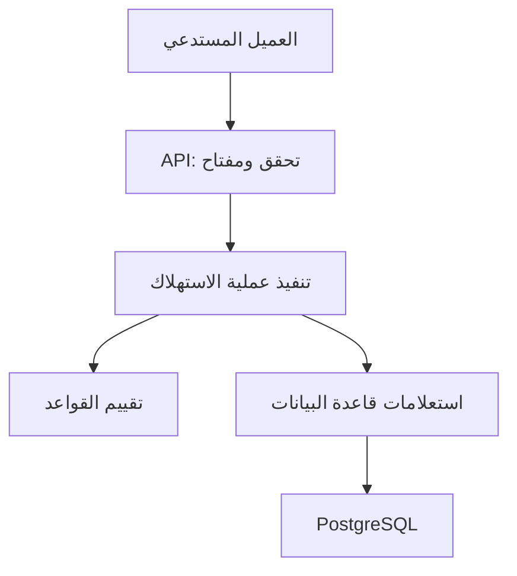

# دليل فهم وبناء مشروع خدمة قياس الاستخدام والحصص
## دليل عربي للمشروع، والقرارات، والأجزاء الثلاثين

**الفترة المذكورة في التكليف:** 12/10/2026 إلى نهاية 20/10/2026.  
**الوقت التقديري المذكور:** 42 ساعة. النص يذكر أيضًا «أسبوعًا»؛ التواريخ أعلاه هي التواريخ الصريحة.  
**حالة هذا الملف:** دليل تصميم وتعلّم قبل التنفيذ؛ ليس تقريرًا عن برنامج منفّذ أو اختبارات ناجحة بالفعل.

---

## كيف تقرأ العلامات؟

| العلامة | معناها |
|---|---|
| **[إلزامي]** | متطلب موجود في التكليف؛ يجب أن يحققه التنفيذ |
| **[مرن — برّر]** | يمكنك اختيار الطريقة أو السلوك؛ وثّق اختيارك وسببه وقيوده |
| **[اقتراح]** | حل مقترح في هذا الدليل، لم يُفرض في التكليف ولم يُعتمد لمجرد كتابته هنا |
| **[مثال]** | أرقام أو سيناريوهات لتوضيح الفكرة، وليست حدودًا مفروضة |
| **[خارج النطاق]** | ميزة لا يطلبها التكليف؛ لا تعطها الأولوية |
| **[تحقق]** | تجربة أو اختبار أو سؤال يثبت فهمك وصحة التنفيذ |

**قاعدة القراءة:** لا تعتبر «أفضل ممارسة» متطلبًا حرفيًا في التكليف. المتطلبات تحدد النتيجة المطلوبة، أما هذا الدليل فيقترح طرقًا لتحقيقها.

## فهرس الدليل

1. وصف المشروع والأطراف وحدود المسؤولية.
2. القواعد المطلوبة بأمثلة.
3. المعمارية والتقنيات المقترحة.
4. الأجزاء الثلاثون بالتفصيل.
5. قاعدة البيانات والـAPI المقترحان.
6. سجل القرارات المرنة.
7. الاختبارات والأداء والتسليم.
8. توزيع العمل والاستعداد للمناقشة.
9. المصادر الرسمية.

---

# 1. ما المشروع بالضبط؟

**[إلزامي]** بناء خدمة Backend تستدعيها تطبيقات أخرى لتسجيل الاستخدام وتحديد هل يمكن لمستخدميها تنفيذ إجراء.

الخدمة تجيب عن سؤال مثل:

> المستخدم أحمد يريد استهلاك مقدار 2. هل حدوده وحدود حساب التطبيق تسمح بذلك؟ إذا سمحت، سجّل الاستهلاك.

الخدمة ليست مجرد فحص دون خصم: **الطلب المقبول يسجّل الاستهلاك**. الطلب المرفوض لا يستهلك شيئًا.

## 1.1 الأطراف

| الطرف | معناه | مسؤوليته |
|---|---|---|
| خدمة القياس التي تبنيها | برنامجك الخلفي | حفظ الخطط والاستهلاك، التحقق، القرار، وإرجاع البيانات |
| Account | التطبيق أو الشركة التي تستدعي خدمتك | تعريف مستخدميها واختيار الخطط وإرسال الطلبات |
| User | مستخدم التطبيق المسجّل تحت الحساب | صاحب الاستهلاك الفردي |
| العميل التجريبي | برنامج صغير ضمن التسليم | إظهار كيفية استدعاء خدمتك والسيناريوهات المطلوبة |

**[إلزامي]** المستخدم يتبع حسابًا، والحساب له خطة، والمستخدم له خطة. لا يكفي بناء رصيد فردي دون مستوى الحساب.

الحساب ليس بالضرورة شركة تجارية، والمستخدم ليس بالضرورة موظفًا. الحساب قد يمثل تطبيقًا، والمستخدم قد يكون زبون ذلك التطبيق.

## 1.2 مثال توليد الصور

**[اقتراح]** نستخدم توليد الصور موضوعًا للعميل التجريبي. كل صورة مطلوبة تمثل استهلاكًا واحدًا.

**[مرن — برّر]** نوع المورد وكيفية حساب تكلفة الإجراء اختيار منك. التكليف يطلب موردًا واحدًا فقط، ولا يفرض الصور أو الصفحات.

في هذا المثال:

- المستخدم يطلب صورتين من تطبيق الشركة.
- تطبيق الشركة يرسل لخدمتك مقدار الاستهلاك 2.
- خدمتك تقبل وتسجّل 2 أو ترفض دون خصم.
- العميل يعرض محاكاة توليد الصور بعد القبول.

**[خارج النطاق]** بناء نموذج ذكاء اصطناعي أو شراء خدمة توليد صور حقيقية. التكليف يسمح بمحاكاة الإجراء.

## 1.3 كيف تتوافق بيانات الشركة مع خدمتك؟

**[إلزامي]** توثيق تنسيقات الطلبات والردود. التطبيق المستدعي يحوّل بياناته إلى الشكل الذي تحدده الـAPI.

لا يلزم تطابق جداول الشركة مع جداولك. المطلوب تسجيل المستخدم في خدمتك، ثم استخدام معرّفه وإرسال المقدار ومعرّف الطلب والمفتاح.

**حد مسؤولية مهم:** الخدمة تتحقق من البيانات المرسلة والحدود؛ التكليف لا يطلب إثبات أن الشركة نفذت الإجراء فعلًا، ولا اكتشاف مقدار الاستهلاك الحقيقي من أنظمتها.

**[مرن — برّر]** إذا قُبل الاستهلاك ثم فشل الإجراء لدى التطبيق، ماذا يحدث؟ الاسترداد خارج النطاق، لذلك اقترح توثيق أن الاستهلاك يسجّل عند القبول، ولا يوجد إرجاع تلقائي. لا تصف هذا بأنه نظام حجز ثم تسوية ما لم تنفّذه فعلًا.

---

# 2. القواعد الأساسية بأمثلة

## 2.1 حد الحساب وحد المستخدم

**[إلزامي]** تطبق خطة الحساب وخطة المستخدم معًا.

**[مثال]**

| صاحب الخطة | الحد الشهري | الحد لكل طلب |
|---|---:|---:|
| حساب التطبيق | 100 | 10 |
| أحمد | 30 | 3 |
| سارة | 80 | 5 |

إذا استهلك أحمد 20 وسارة 40، استهلاك الحساب 60. هذا ليس رصيدًا إضافيًا يُصرف مرتين؛ نفس الإجراء يدخل في إجمالي صاحبه وإجمالي الحساب.

حدود المستخدمين قد يكون مجموعها أكبر من حد الحساب. حساب 100 ومستخدمان بحدّي 30 و80 ممكن؛ الحد المشترك يظل سقفًا ملزمًا.

## 2.2 شروط قبول طلب جديد

**[إلزامي]** المقدار عدد صحيح موجب. قبول كامل فقط إذا سمحت جميع القواعد المطبقة.

يجب فحص:

1. حد الحساب لكل طلب.
2. حد المستخدم لكل طلب.
3. الحصة الشهرية للحساب.
4. الحصة الشهرية للمستخدم.

**[مرن — برّر]** ترتيب الفحص عند مخالفة أكثر من قاعدة. التكليف يطلب تحديد قاعدة مانعة وصاحبها، ولا يفرض إرجاع جميع المخالفات.

**[مثال]** بقي للحساب 1، ولأحمد 10، وطلب أحمد 2: يرفض بسبب الحساب، ولا يخصم 1 أو 2 من أي طرف.

## 2.3 الخطط

**[إلزامي]** خطط جاهزة للحسابات وللمستخدمين عند بدء التشغيل. اختر حدودًا معقولة ووثّقها.

**[إلزامي]** الحساب يستطيع إنشاء خططه الخاصة وعرضها وتحديثها وإسنادها إلى نفسه أو مستخدميه.

**[مرن — برّر]** إبقاء الخطط الجاهزة للقراءة فقط مسموح. أقترحه لتفادي تعديل تعريف مشترك بين حسابات مختلفة.

عدة مستخدمين يشتركون في تعريف الخطة، **ولا يشتركون في استهلاكهم الفردي**.

## 2.4 تغيير الخطة

**[إلزامي]** بعد نجاح التحديث، تطبق الإعدادات الجديدة على الطلبات الجديدة دون إعادة نشر الخدمة.

- تغيير خطة الحساب يغير حدود الحساب.
- تغيير خطة أحمد يغير حدود أحمد.
- تعديل خطة خاصة مشتركة يؤثر في جميع المسندين إليها.
- الاستهلاك السابق لا يصفّر.
- الطلبات القديمة وتاريخها لا يعاد كتابتها.

المتبقي الحالي = max(0, الحد الحالي − الاستهلاك خلال الشهر).

| الحد | الاستهلاك | المتبقي |
|---:|---:|---:|
| 100 | 50 | 50 |
| 200 | 50 | 150 |
| 50 | 50 | 0 |
| 30 | 50 | 0 |

إذا خُفّض الحد تحت المستهلك، يبقى المستهلك كما هو. لا يُخفض إلى الحد الجديد.

## 2.5 الأشهر

**[إلزامي]** استخدام الشهر التقويمي بتوقيت UTC. ليس 30 يومًا من التسجيل، وليس توقيت الجهاز المحلي.

**[اقتراح]** حفظ صف لكل حساب وشهر وصف لكل مستخدم وشهر، وإنشاء صف الشهر عند الحاجة باستهلاك صفر. هذا يغني عن مهمة تمسح أو تصفّر الاستهلاك.

**[مرن — برّر]** تحديد لحظة المعالجة بدقة إذا انتظر الطلب قفلًا عند نهاية الشهر. اقترح أخذ وقت واحد بعد الحصول على القفل واستخدامه للشهر والتاريخ. انتبه إلى أن وقت بداية المعاملة في SQL قد يختلف عن الوقت الفعلي بعد الانتظار.

## 2.6 الحماية والحفظ

**[إلزامي]** مفتاح في ترويسة الطلب يحدد الحساب. رفض المفتاح المفقود أو غير الصحيح، والتحقق من ملكية المستخدم.

**[إلزامي]** حفظ الحسابات والمستخدمين والخطط والإسنادات والاستخدام والتاريخ في قاعدة البيانات، واستمرارها بعد إعادة التشغيل.

---

# 3. المعمارية المقترحة

## 3.1 التقنيات

| التقنية | التصنيف | السبب أو المطلوب |
|---|---|---|
| TypeScript | [إلزامي] | اللغة المحددة |
| PostgreSQL وSQL | [إلزامي] | قاعدة البيانات المحددة |
| Docker Compose | [إلزامي] | تشغيل كامل المجموعة بالأمر المطلوب |
| Node.js | [اقتراح] | بيئة تشغيل الخدمة |
| Fastify | [مرن — برّر] | استقبال HTTP والتحقق من الطلبات ودعم الاختبار |
| pg | [مرن — برّر] | تنفيذ SQL ومعاملات واضحة |
| SQL migrations | [اقتراح] | تطوير مخطط القاعدة بملفات مرتبة |
| عميل صفحة بسيطة أو CLI | [مرن — برّر] | كلاهما مقبول صراحةً |

اختيار pg بدل ORM لا يعني أن ORM سيئ. نختار SQL المباشر هنا كي تكون الاستعلامات والأقفال واضحة للمناقشة. التكلفة: كتابة تحويل البيانات والاستعلامات يدويًا.

## 3.2 حدود المسؤوليات

| الجزء | يفعل | لا نضع فيه |
|---|---|---|
| routes/schemas | يقرأ الطلب، يتحقق من شكله، يعيد الرد | حسابات الرصيد المعقدة |
| services | يرتب العملية والمعاملة والقراءات والكتابات | تفاصيل عرض الواجهة |
| rules | يقارن الحدود والاستهلاك والمطلوب | استعلامات SQL وHTTP |
| repositories | يقرأ ويكتب SQL | تقرير سياسة رفض جديدة |
| database/config | الاتصالات والإعدادات والمهاجرات | قواعد المنتج |

**[مرن — برّر]** أسماء المجلدات وعدد الملفات. الفصل مسؤوليات وليس شرطًا لإنشاء كلاس وواجهة لكل دالة.

## 3.3 رسم علاقة الأجزاء



**[اقتراح]** خدمة واحدة. التكليف يقول إن خدمة وقاعدة واحدة تكفيان. لا نضيف Redis أو طوابير أو خدمات متعددة دون حاجة مثبتة.

---

# 4. الأجزاء الثلاثون بالتفصيل

## الجزء 1: شكل الطلب والرد

**الهدف:** فهم أن Backend يستقبل رسالة HTTP ويرجع رسالة، وليس شاشة تلقائيًا.

**[إلزامي]** تصميم وتوثيق API. **[مرن — برّر]** المسارات والحقول وأكواد الاستجابة.

**[مثال]** طلب استهلاك يحمل userId وunits وrequestId؛ الرد يحمل accepted وسبب الرفض إن وجد.

**تنفيذ صغير:** مسار صحة يعيد JSON، ثم تجربة من أداة API أو سطر الأوامر.

**لماذا الفصل؟** معرفة ما يأتي من الشبكة وما ينتمي للكود الداخلي تمنع الخلط بين التحقق من المدخلات وقواعد الرصيد.

**[تحقق]** اشرح الفرق بين فشل الوصول ورفض بسبب نفاد الرصيد. هل كل رفض يعني تعطل الخدمة؟ لا.

## الجزء 2: TypeScript الضرورية

**الهدف:** فهم الأنواع والدوال والكائنات والوحدات وPromise وasync/await المستخدمة فعليًا.

**[إلزامي]** كتابة TypeScript. **[اقتراح]** تشغيل strict وتقليل any.

**[مثال]** نوع قرار يحتوي accepted كقيمة منطقية، وscope كحساب أو مستخدم عند الرفض.

**قرار:** الأنواع تقلل أخطاء التطوير، لكنها لا تفحص JSON الخارجي عند التشغيل وحدها. نحتاج تحققًا فعليًا من الطلب.

**[تحقق]** لماذا تعريف units: number لا يمنع العميل من إرسال نص؟ ولماذا await لا يمنع طلبين من التنفيذ بالتزامن؟

## الجزء 3: بدء الخدمة

**الهدف:** فصل إنشاء التطبيق عن تشغيله على منفذ، لتسهيل الاختبار.

**[اقتراح]** buildApp ينشئ التطبيق، وserver يبدأ الاستماع.

**[مرن — برّر]** اختيار Fastify مقابل Express أو غيره. اختياري Fastify للتحقق والتسجيل واختبار المسارات المتكامل، وليس لادعاء تفوق أداء دون قياس.

**[مثال]** /health/live يدل على أن العملية تعمل؛ readiness يتحقق من جاهزية الخدمة للاستخدام.

**[تحقق]** هل بدء العملية يعني أن القاعدة مهيأة؟ لا.

## الجزء 4: الإعدادات

**الهدف:** قراءة المنفذ وDATABASE_URL وما يلزم من بيئة التشغيل.

**[اقتراح]** تحقق من الإعدادات عند البداية، وملف مثال لا يحتوي أسرارًا حقيقية.

**[مرن — برّر]** القيم الافتراضية وحدود الانتظار والاتصالات.

**سبب:** اكتشاف إعداد مفقود عند البداية أوضح من ظهور أخطاء مبهمة بعد أول طلب.

**[تحقق]** كيف تغير المنفذ دون تعديل الكود؟ ماذا يظهر إذا كان عنوان القاعدة مفقودًا؟ لا تطبع كلمة المرور في الخطأ.

## الجزء 5: الاتصال بقاعدة البيانات

**الهدف:** فهم Pool: مجموعة اتصالات يعاد استخدامها.

**[اقتراح]** Pool واحد للخدمة، بحد معلوم ومهلة انتظار.

**[إلزامي للصحة في التنفيذ المقترح]** جميع استعلامات معاملة واحدة تستخدم نفس الاتصال، ثم يعاد الاتصال إلى المجموعة في finally.

**[مرن — برّر]** حجم المجموعة بناءً على البيئة والقياس؛ زيادته لا تضمن زيادة السرعة.

**[تحقق]** لماذا BEGIN عبر اتصال وتحديث عبر آخر لا يشكلان معاملة واحدة؟ ماذا يحدث إذا نسينا تحرير الاتصال؟

## الجزء 6: إنشاء الجداول وتطويرها

**الهدف:** فهم migrations: تغييرات مرتبة في تصميم القاعدة.

**[إلزامي]** تهيئة القاعدة أثناء التشغيل. **[مرن — برّر]** أداة المهاجرات وطريقتها.

**[اقتراح]** ملفات SQL مرقمة، وجدول يتتبع المطبق، وتشغيلها قبل قبول الطلبات. لا تستخدم حذف القاعدة وإعادة إنشائها في كل تشغيل.

**سبب:** التشغيل الثاني يجب أن يحافظ على البيانات، ولا يكرر البنية أو الخطط.

**[تحقق]** جرّب قاعدة فارغة ثم قاعدة موجودة. كيف تمنع تشغيل مهاجرتين متداخلتين إذا شغلت نسختين؟ وثّق نطاق التشغيل المدعوم.

## الجزء 7: الحسابات

**الهدف:** إنشاء Account وحفظ خطته الحالية.

**[إلزامي]** إنشاء حساب وإصدار مفتاح له. **[مرن — برّر]** التسجيل الأولي قبل وجود مفتاح.

**[اقتراح]** عملية تسجيل أولية عامة للعرض المحلي، تصدر المفتاح مرة واحدة. وثّق أنها ليست نظام تسجيل إنتاجي كاملًا.

**قرار:** إنشاء الحساب والمفتاح وخطته يجب ألا يترك حسابًا ناقصًا إذا فشل الحفظ.

**[تحقق]** كيف يحصل أول حساب على المفتاح؟ هل يستطيع إنشاء نفسه بإسناد خطة خاصة لحساب آخر؟ يجب ألا يستطيع.

## الجزء 8: مفاتيح API

**الهدف:** مفتاح صعب التخمين، وتحديد الحساب منه.

**[إلزامي]** المفتاح في ترويسة ورفض المفقود وغير الصحيح. **[مرن — برّر]** اسم الترويسة وتنسيق المفتاح.

**[اقتراح]** توليد عشوائي تشفيري، حفظ بصمة للمفتاح بدل النص الأصلي، وعدم إظهاره في السجلات. بصمة مفتاح عشوائي عالي القوة تختلف عن تخزين كلمات مرور يختارها بشر.

**[مرن — برّر]** دعم تدوير المفتاح أو إلغائه ليس مطلوبًا صراحةً. لا تضفه إذا أخر الأساس.

**[تحقق]** هل المفتاح يثبت هوية المستخدم الفردي؟ لا؛ يحدد الحساب المستدعي.

## الجزء 9: عزل الحسابات

**الهدف:** لا يصل حساب إلى مستخدم أو خطة خاصة أو تاريخ حساب آخر.

**[إلزامي]** العزل والتحقق من ملكية المستخدم.

**[اقتراح]** تمرير accountId المستخرج من المفتاح في استعلامات البيانات، والبحث بشرط account_id ومعرّف العنصر.

**[مرن — برّر]** إرجاع 404 بدل 403 عند طلب عنصر لغير الحساب حتى لا تكشف وجوده؛ اختر سلوكًا متسقًا.

**[تحقق]** اختبر العزل في التعديل والقراءة والسجل، وليس الاستهلاك فقط. لا تثق بـaccountId يرسله العميل لتحديد الهوية.

## الجزء 10: المستخدمون

**الهدف:** حفظ User تابع لحساب وبخطة مستخدم.

**[إلزامي]** التسجيل والإسناد والتغيير. **[مرن — برّر]** المعرّف الداخلي وإضافة externalId للتطبيق.

**[اقتراح]** UUID داخلي؛ externalId اختياري وفريد داخل الحساب إن استخدمناه. لا تجعله فريدًا عالميًا دون سبب.

**[مثال]** مستخدمان في شركتين قد يحملان الرقم الخارجي نفسه دون أن يكونا نفس المستخدم.

**[تحقق]** لماذا userId وحده لا يكفي لحماية القراءة؟ ما البيانات المطلوبة فعلًا؟ لا تضف ملفًا شخصيًا كبيرًا دون حاجة.

## الجزء 11: تعريف الخطة

**الهدف:** اسم وحد شهري وحد لكل طلب ونوع حساب/مستخدم ومالك للخطة الخاصة.

**[إلزامي]** القاعدتان للمستويين. **[مرن — برّر]** تمثيل القواعد.

**[اقتراح]** أعمدة صريحة للقاعدتين بدل محرك عام للقواعد داخل JSON. هذا يسهل القيود والاستعلام والفهم.

**المقارنة:** JSON مرن لإضافة قواعد كثيرة، لكنه يحتاج تحققًا وإصدارات وبناء تفسير؛ الأعمدة أبسط هنا.

**[مرن — برّر]** هل الحد صفر مسموح لإيقاف الاستخدام؟ النص يشترط إيجابية الاستهلاك، ولا يحدد نطاق إعدادات الحدود بالكامل. حدد السياسة.

**[تحقق]** هل نقبل خطة حد الطلب فيها أكبر من الشهري؟ يمكن أن تظل صحيحة؛ لا تضف رفضًا بلا توثيق.

## الجزء 12: الخطط الجاهزة

**الهدف:** وجود خطط حساب ومستخدم بعد بداية الخدمة.

**[إلزامي]** اختيار حدود معقولة وتوثيقها. أسماء Starter وغيرها أمثلة فقط.

**[اقتراح]** رمز ثابت لكل خطة وإدراج لا يكررها. تبقى للقراءة فقط.

**قرار مهم:** لا تجعل بدء الخدمة يكتب فوق بيانات معدلة أو يغير خطة جاهزة بصمت بين نسختين. تغييرات التعريفات تتم بطريقة موثقة.

**[تحقق]** تشغيل الخدمة مرتين لا يضاعف الخطط؛ هل توجد خطط جاهزة لكلا المستويين؟

## الجزء 13: الخطط الخاصة

**الهدف:** حساب ينشئ ويقرأ ويعدل خطته الخاصة.

**[إلزامي]** لا يشارك الحساب ملكية خططه الخاصة مع حساب آخر.

**[مرن — برّر]** تفرّد الاسم داخل الحساب والنوع، أو السماح بتكراره واستخدام المعرّف.

**[اقتراح]** التحقق من نوع الخطة ومالكها عند كل إسناد أو تعديل، ومن نطاق الأرقام.

**[تحقق]** خطة تملكها الشركة أ لا تسندها الشركة ب لمستخدمها. تعديل خطة مشتركة بين مستخدمين يجب أن يؤثر في كليهما.

## الجزء 14: إسناد الخطط

**الهدف:** اختيار خطة للحساب وخطة لكل مستخدم.

**[إلزامي]** بقاء الاستهلاك عند التبديل. **[مرن — برّر]** عمود current_plan_id أم جدول إسناد منفصل.

**[اقتراح]** عمود للخطة الحالية يكفي؛ التاريخ يشرح القرارات بلقطات محفوظة. سجل إسنادات مستقل إضافة ممكنة، لا يلزم تاريخ كامل لكل تعديل إذا لم نحتج إليه.

**[تحقق]** منع إسناد خطة حساب إلى مستخدم إذا اخترنا الفصل بالأنواع. لماذا لا يخزّن الرصيد في صف الخطة المشتركة؟

## الجزء 15: تغيير الخطط

**الهدف:** تطبيق حدود جديدة بعد نجاح التحديث دون تصفير أو نشر.

**[إلزامي]** أثر فوري للطلبات الجديدة وبقاء التاريخ.

**[اقتراح]** تعديل خطة خاصة أو تبديل إسناد داخل معاملة، وبروتوكول قفل الحساب نفسه المستخدم في الاستهلاك.

**المقارنة:** تأجيل التغيير للشهر التالي يخالف السلوك المطلوب هنا. تحديث القاعدة دون تنسيق مع الاستهلاك قد يسمح بقراءة حدود قديمة في وقت غير متوقع.

**[تحقق]** طلب يبدأ بعد نجاح التحديث يرى الجديد. طلب متداخل معه نحدد ترتيبه بوضوح. اختبر تغييرًا يؤثر في مستخدمين عدة.

## الجزء 16: التحقق من مدخلات الاستهلاك

**الهدف:** التمييز بين بيانات غير صالحة وقرار رفض سليم.

**[إلزامي]** userId، مقدار صحيح موجب، requestId.

**[مرن — برّر]** أطوال المعرفات، رفض الحقول الزائدة، وأقصى قيمة رقمية.

**[اقتراح]** نطاق محدد متوافق مع دقة JavaScript وSQL، وحد حجم للطلب. مخطط تحقق عند التشغيل؛ الأنواع وحدها لا تكفي.

**[تحقق]** 0، -1، 1.5، نص، قيمة ضخمة، ومعرّف ناقص. لا تحول المدخلات بصمت دون سياسة.

## الجزء 17: شهر المعالجة

**الهدف:** اختيار الشهر الواحد الذي ينتمي إليه القرار الجديد.

**[إلزامي]** UTC، وحفظ الأشهر السابقة.

**[اقتراح]** month_start من نوع date يمثل أول الشهر؛ processed_at من نوع timestamptz. استخدام وقت واحد لكل خطوة.

**[مرن — برّر]** مصدر الوقت وتعريف لحظة المعالجة. إعادة طلب قديم في شهر جديد تعيد الأصل في السياسة المقترحة، ولا تنشئ استهلاكًا جديدًا.

**[تحقق]** حدود نهاية الشهر، سنة جديدة، وطلب انتظر القفل. الاختبار يجب أن يتحكم في الوقت بدل انتظار الشهر فعليًا.

## الجزء 18: تقييم القواعد

**الهدف:** دالة بسيطة تستقبل المطلوب والحدود والمستهلك وتعيد قرارًا.

**[إلزامي]** كل الطلب يلتزم بحدود الحساب والمستخدم.

**[اقتراح]** دالة دون SQL أو HTTP؛ نختبرها بأرقام صغيرة. ترتيب ثابت: حد الحساب للطلب، المستخدم للطلب، الحساب للشهر، المستخدم للشهر.

**[مرن — برّر]** الترتيب المقترح ليس مفروضًا. الرصيد الشخصي والمشترك يتساويان في الإلزام.

**[تحقق]** الحد يساوي المطلوب يقبل إذا كفى الرصيد؛ الحد أقل بواحد يرفض. سبب الرفض يتضمن نوع القاعدة وصاحبها.

## الجزء 19: المستهلك والمتبقي

**الهدف:** المجاميع الشهرية ورصيد العرض.

**[إلزامي]** استهلاك الحساب مجموع المقبول لمستخدميه؛ المتبقي لا يكون سالبًا عند خفض الخطة.

**[اقتراح]** حفظ المستهلك، وحساب المتبقي. فصل جدول مستخدمين شهري وجدول حسابات شهري.

**المقارنة:** جمع السجل كل مرة يقلل البيانات المكررة لكنه قد يزيد كلفة الاستعلام. المجاميع أسرع للقراءة لكنها تحتاج تحديثًا ذريًا وتحققًا من التطابق.

**[تحقق]** تحديث خطة لا يغير المستهلك. تخفيض الحد لا يعيد كتابة الاستهلاك.

## الجزء 20: المعاملة

**الهدف:** الاستهلاك الفردي والمشترك والقرار تنجح معًا أو لا ينجح أي منها.

**[إلزامي]** النتيجة الصحيحة والحفظ وعدم الخصم الجزئي. **[اقتراح]** BEGIN ثم الخطوات ثم COMMIT، وعند الخطأ ROLLBACK.

**تفصيل:** رفض بسبب قاعدة نتيجة طبيعية تُحفظ ثم تنتهي المعاملة بنجاح؛ ليس خطأ قاعدة بيانات. أما فشل الكتابة فيلغي الجميع.

**[تحقق]** أحدث فشلًا بعد أول تحديث، وافحص أن الطرفين والتاريخ لم يتغيروا جزئيًا. لا ترجع قبولًا قبل COMMIT.

## الجزء 21: الطلبات المتزامنة والأقفال

**الهدف:** طلبان لا يصرفان الرصيد نفسه، وتحديث الخطة لا يتداخل بصورة خاطئة.

**[اقتراح]** READ COMMITTED مع SELECT FOR UPDATE على صف الحساب، ثم تنفيذ كل كتابات الحساب ذات الصلة تحت القفل نفسه.

هذا يجعل عمليات نفس الحساب تتتابع؛ الحسابات المختلفة تستمر بالتوازي. أقترحه لبساطة الإثبات، لا باعتباره أعلى أداء ممكن.

**شرط الصحة:** كل مسار يغير الخطط أو إسناداتها أو الاستخدام يتبع نفس بروتوكول القفل. القفل على المستخدم وحده غير كافٍ للرصيد المشترك.

**[مرن — برّر]** بدائل: أقفال أدق أو تحديثات شرطية أو SERIALIZABLE مع إعادة محاولات. لكل منها تعقيد وفائدة يجب اختبارهما.

**[تحقق]** رصيد 10 ومئة طلب كل منها 1: المقبول لا يزيد على 10. المعاملة قصيرة، ولا تستدعي خدمة صور خارجية وهي تحمل القفل.

## الجزء 22: إعادة المحاولة ومعرّف الطلب

**الهدف:** عدم تكرار الخصم بعد فقد الرد.

**[إلزامي]** إعادة محاولات آمنة، ومدخل requestId. **[مرن — برّر]** المعنى التفصيلي للتكرار.

**[اقتراح]** معرّف فريد داخل الحساب، لا عالميًا. نفس المستخدم والمقدار يعيد الرد الأصلي. بيانات مختلفة بنفس المعرّف ترجع تعارضًا. الرفض النهائي بسبب قاعدة يحفظ أيضًا.

بذلك الطلب المرفوض يبقى مرفوضًا عند إعادته بعد رفع الخطة؛ محاولة جديدة تحتاج معرّفًا جديدًا. أخطاء الشبكة أو فشل المعاملة ليست قرارًا محفوظًا مكتملًا.

**[تحقق]** إعادة متزامنة، فقد الرد بعد COMMIT، نفس الرقم لدى حسابين، إعادة في شهر جديد، ومدخلات مختلفة.

## الجزء 23: عرض الاستخدام الحالي

**الهدف:** API يعيد الخطط والحدود والمستهلك والمتبقي.

**[إلزامي]** عرض الحساب والمستخدمين والخطط الحالية.

**[اقتراح]** استعلام متسق أو معاملة قراءة بلقطة واحدة إذا استلزم الرد قراءات عدة؛ لا تجمع أرقامًا من لحظتين مختلفتين وتقدمها كلقطة واحدة.

**[مرن — برّر]** تجميع الردود أو فصل المسارات.

**[تحقق]** قراءة أثناء استهلاك متزامن لا تعرض زيادة الحساب دون المستخدم باعتبارها حالة واحدة. الباقي المرسل في رد قديم يمثل وقت ذلك الرد، لا ضمانًا دائمًا.

## الجزء 24: الأشهر السابقة ومعنى الحدود التاريخية

**الهدف:** قراءة الاستخدام السابق دون إفساد تفسيره عند تعديل الخطط.

**[إلزامي]** الأشهر السابقة متاحة والتاريخ محفوظ. **[مرن — برّر]** أي حد نستخدم لعرض «المتبقي» لشهر انتهى وتغيرت خطته أثناءه؟

التكليف لا يحدد سياسة الحد التاريخي كاملة. لا يكفي استخدام الحد الحالي وتسميته حد أكتوبر.

**[اقتراح]** عرض المستهلك التاريخي والشهر بوضوح؛ حفظ حدود القرار والخطة في سجل كل طلب. إذا سنعرض متبقيًا تاريخيًا، نختار قاعدة صريحة مثل الحد المطبق عند نهاية الشهر، ونحفظ التاريخ اللازم حتى لو لم توجد طلبات قرب نهايته.

لقطة آخر طلب وحدها لا تثبت حد نهاية الشهر إذا تعدلت الخطة بعده. قد نحتاج سجل تغييرات فعليًا أو ملخصًا موثوقًا.

**[تحقق]** شهر قديم ثم تعديل خطة اليوم: هل يتغير تفسير قرارات الشهر القديم؟ يجب ألا يتغير.

## الجزء 25: سجل الطلبات وتقسيم الصفحات

**الهدف:** إرجاع الطلبات المقبولة والمرفوضة بأسبابها.

**[إلزامي]** تاريخ قابل للاستعلام وتقسيم بسيط للصفحات.

**[اقتراح]** ترتيب ثابت بـprocessed_at ومعرّف ثانوي لكسر التعادل، حد أعلى لحجم الصفحة، ومرشحات المستخدم والشهر داخل الحساب.

**[مرن — برّر]** offset/limit أبسط؛ cursor أنسب لتاريخ متزايد وكبير لكن يحتاج تنسيقًا إضافيًا.

**[تحقق]** لا يتسرب تاريخ حساب آخر. عدة طلبات بنفس الوقت لا تضيع بسبب ترتيب غير ثابت.

## الجزء 26: الأخطاء والسجلات

**الهدف:** رد مفيد للعميل ومعلومة كافية لتشخيص المشكلة.

**[إلزامي]** أخطاء مفيدة. **[مرن — برّر]** الأكواد والتنسيق.

**[اقتراح]** رموز ثابتة مثل INVALID_INPUT وINVALID_API_KEY وREQUEST_ID_CONFLICT. قرار الحصة منفصل عن عطل داخلي.

سجل وقت الطلب، مدته، معرّف تتبع، ونتيجته. لا تسجل المفتاح أو كلمة مرور القاعدة.

**[تحقق]** خطأ داخلي لا يعيد stack trace أو SQL حساسًا. مهلة القفل لا تتحول إلى قرار قبول أو خصم جزئي.

## الجزء 27: العميل التجريبي

**الهدف:** إثبات التكامل دون تنفيذ عمل تجاري حقيقي.

**[إلزامي]** مستخدمان بخطط مختلفة، قبول، رفض مستخدم، رفض حساب، تعديل أو تبديل خطة، وعرض القرار والمتبقي.

**[مرن — برّر]** CLI أو صفحة. CLI يقلل عمل الواجهة ويسهل إبقاء المفتاح خارج المتصفح؛ الصفحة أوضح بصريًا.

**تنبيه تصميمي:** مفتاح الحساب يمنح إدارة بياناته، فلا تعرض مفتاح إنتاجي في صفحة عامة. إن استخدمت صفحة محلية بمفتاح تجريبي فوثق نطاقها، أو مرر الطلبات عبر Backend العميل.

**[تحقق]** تغيير الخطة من خلال API دون تغيير كود العميل. السيناريو يعمل بعد تشغيل موثق، لا بخطوات خفية.

## الجزء 28: Docker وتهيئة التشغيل

**الهدف:** تشغيل الخدمة والقاعدة والعميل بالأمر المطلوب.

**[إلزامي]** docker compose up --build، وتهيئة القاعدة والخطط عند البداية.

**[اقتراح]** فحص جاهزية PostgreSQL، ثم migrations وseed، ثم قبول الطلبات. استخدام volume للبيانات.

**[مرن — برّر]** مهمة تهيئة منفصلة أو تهيئة داخل بداية الخدمة؛ كلاهما ممكن إذا كانت النتيجة موثوقة.

**[تحقق]** بيئة جديدة تمامًا، إعادة التشغيل، حفظ البيانات، والتوقف المنظم. حذف volume عمدًا يحذف البيانات؛ لا تعد المستخدم بحفظ بعد هذا الحذف.

## الجزء 29: الاختبارات والأداء

**الهدف:** إثبات النتيجة وقياس الاختناقات.

**[إلزامي]** اختبارات تلقائية ونتائج تحميل مع أدوات وأوامر قابلة لإعادة التنفيذ.

**[اقتراح]** اختبارات قواعد منفردة، واختبارات API بقاعدة حقيقية، واختبارات تزامن حقيقية باتصالات متعددة.

**[مرن — برّر]** أداة التحميل وحجم العمل؛ لا نخترع أرقام نتائج.

قِس معدل الطلبات وأزمنة p50/p95/p99 والأخطاء، وميّز رفض الحصة المتوقع عن الفشل التقني. اختبر حسابًا مزدحمًا وعدة حسابات، ومعرّفات جديدة ومكررة، وتحديث خطة أثناء العمل.

**[تحقق]** بعد الحمل، مجموع المقبول يساوي مجاميع المستخدمين والحساب. سرعة رد جيدة مع إجماليات خاطئة ليست نجاحًا.

## الجزء 30: README والمناقشة

**الهدف:** شخص آخر يشغل المشروع، وأنت تشرح كل قرار وتتتبع طلبًا.

**[إلزامي]** README بالمحتوى المطلوب وتسليم GitHub والملفات والاختبارات والنتائج.

**[اقتراح]** سجل قرار قصير لكل اختيار: المشكلة، الحل، البديل، السبب، العيب، ودليل الاختبار.

**[تحقق]** تتبع طلب من المفتاح إلى COMMIT والرد. عدل قاعدة صغيرة، وشغّل اختبارًا يثبت أثرها. لا تحفظ كلامًا يخالف الكود.

**معيار الإتقان:** تعرف ما يفعله الجزء، ولماذا موجود، وماذا يحدث عند فشله، وكيف تثبت صحته.

---

# 5. قاعدة البيانات المقترحة

هذه بداية تصميم، لا مخطط نهائي مفروض.

| الجدول | أهم المعلومات المقترحة | قيد مهم |
|---|---|---|
| accounts | id، name، current_plan_id، created_at | الخطة من نوع حساب ومسموحة لهذا الحساب |
| api_keys | id، account_id، key_digest، created_at | بصمة فريدة، وربط بالحساب |
| users | id، account_id، name، current_plan_id | ارتباط الحساب والخطة المسموحة |
| plans | id، name، scope، owner_account_id، monthly_allowance، max_per_request | حدود ضمن نطاق معلن؛ مالك فارغ للجاهزة في اقتراحنا |
| account_monthly_usage | account_id، month_start، consumed | فريد للحساب والشهر؛ المستهلك غير سالب |
| user_monthly_usage | account_id، user_id، month_start، consumed | فريد للمستخدم والشهر؛ المستخدم تابع للحساب |
| consumption_requests | account_id، request_id، user_id، units، accepted، reason، processed_at، month_start، لقطات القرار | فريد للحساب ومعرّف الطلب |

**[اقتراح]** تضمين القيود الأجنبية وNOT NULL وCHECK وUNIQUE بدل الاعتماد على الكود وحده.

**تفصيل:** المفتاح الأجنبي إلى plans وحده لا يضمن نوع الخطة ومالكها. نحتاج تحققًا في الخدمة، أو قيودًا مركبة/تصميمًا آخر إذا أردنا ضمانًا في القاعدة أيضًا. يجب ألا نزعم أن FK بسيط يحقق كل العزل.

**[مرن — برّر]** عدد صحيح SQL من نوع integer مع سقف موثق، أو bigint مع معالجة دقيقة لتحويله إلى JavaScript/JSON. لا تحول bigint كبيرًا إلى number دون التحقق من الدقة.

**الفهارس المقترحة:**

- بصمة مفتاح الوصول.
- users(account_id, id).
- plans(owner_account_id, scope).
- مفاتيح الشهر الفريدة.
- تاريخ الطلبات حسب account_id وprocessed_at وid.
- فهرس حساب ومستخدم وتاريخ إذا كان هذا المرشح متكررًا.

نضيف الفهارس تبعًا للاستعلامات والقياس؛ كل فهرس له تكلفة كتابة وتخزين.

---

# 6. API مقترح، وليس مفروضًا

**[مرن — برّر]** جميع الأسماء التالية أمثلة تصميم.

| العملية | مثال المسار |
|---|---|
| تسجيل حساب وإصدار المفتاح | POST /accounts |
| عرض الخطط المتاحة | GET /plans |
| إنشاء خطة خاصة | POST /plans |
| تعديل خطة خاصة | PATCH /plans/:planId |
| تغيير خطة الحساب | PATCH /account/plan |
| إنشاء مستخدم | POST /users |
| عرض المستخدم وخطته | GET /users/:userId |
| تغيير خطة مستخدم | PATCH /users/:userId/plan |
| طلب استهلاك | POST /consumptions |
| عرض استخدام الحساب | GET /account/usage?month=2026-10 |
| عرض استخدام مستخدم | GET /users/:userId/usage?month=2026-10 |
| سجل الطلبات | GET /requests?limit=20&offset=0 |

كل عمليات الحساب ومستخدميه تحتاج المفتاح؛ التسجيل الأولي استثناء تصميمي موثق لأن المفتاح لم يصدر بعد.

**[مثال]**

```json
{
  "userId": "user-123",
  "units": 2,
  "requestId": "operation-456"
}
```

**رد رفض مقترح:**

```json
{
  "accepted": false,
  "requestId": "operation-456",
  "reason": {
    "scope": "account",
    "rule": "monthly_allowance"
  },
  "account": { "consumed": 99, "remaining": 1 },
  "user": { "consumed": 5, "remaining": 15 }
}
```

هذه الأرقام مثال. اللقطات في رد إعادة الطلب تمثل القرار الأصلي في اقتراحنا؛ الاستخدام الحالي يؤخذ من مسار الاستخدام.

**[مرن — برّر]** استخدام 200 لقرار استهلاك مقبول أو مرفوض مع accepted، و400 للمدخلات و401 للمفتاح و404 للعنصر غير المتاح و409 لتعارض معرّف الطلب، اقتراح قابل للتعديل. القرار التجاري ليس بالضرورة خطأ HTTP.

---

# 7. سجل القرارات التي تحتاج تبريرًا

لا تكتفِ بكتابة «اخترت لأنه أفضل». اشرح أفضل لأي هدف وما ثمنه.

| القرار | اقتراح مبدئي | البديل أو السؤال الذي تناقشه |
|---|---|---|
| إطار HTTP | Fastify | Express/NestJS؛ ما أثره على البساطة والاختبار؟ |
| الوصول للقاعدة | pg وSQL مباشر | ORM؛ وضوح المعاملات مقابل إنتاجية كتابة البيانات |
| تمثيل القواعد | أعمدة صريحة | JSON أو محرك عام؛ هل التعقيد مطلوب؟ |
| المجاميع | صفوف شهرية مع سجل | جمع السجل؛ الأداء مقابل تكرار البيانات |
| حماية التزامن | قفل الحساب | أقفال أدق أو SERIALIZABLE؛ انتظار مقابل تعقيد |
| تنسيق تغيير الخطط | نفس قفل الحساب | قفل استهلاك دون تعديل الخطط لا يكفي |
| الخطط الجاهزة | قراءة فقط | تعديل مشترك يحتاج سياسة أخرى |
| نوع الخطة | حساب/مستخدم صريح | خطة مشتركة الأنواع؛ ما القيود؟ |
| مفتاح API | بصمة لمفتاح عشوائي | حفظ النص؛ خطر كشفه |
| التسجيل الأولي | عملية محلية موثقة | مفتاح تهيئة؛ كيف يصل أول حساب؟ |
| تكرار معرّف الطلب | نفس الرد، المختلف تعارض | إعادة تقييم الرفض؛ متى يصبح طلبًا جديدًا؟ |
| نطاق المعرّف | داخل الحساب | عالمي؛ هل له فائدة؟ |
| أول سبب رفض | ترتيب ثابت | كل الأسباب؛ تكلفة ووضوح |
| التاريخ | لقطات حدود القرار | إصدارات خطط؛ ما الذي تحتاج استرجاعه؟ |
| حد شهر قديم | سياسة واضحة لم تُحسم بعد | نهاية الشهر/لقطات؛ لا تختلق تاريخًا |
| وقت الشهر | بعد القفل | وقت الوصول؛ أي معنى للمعالجة؟ |
| الحدود صفر | قرار يجب حسمه | منع الخطة أو استخدامها لإيقاف الاستهلاك |
| نطاق الأعداد | سقف آمن معلن | bigint مع تحويلات دقيقة |
| تقسيم السجل | offset بسيط | cursor؛ حجم وتغير التاريخ |
| العميل | CLI أو صفحة محلية | وضوح العرض مقابل عمل الواجهة وحماية المفتاح |
| رفض الوصول لعناصر غير مملوكة | 404 مقترح | 403؛ كشف وجود العنصر |
| استهلاك ثم فشل الإجراء | لا استرداد في النطاق | حجز/تسوية خارج المطلوب |
| حذف حساب/مستخدم/خطة | لا API حذف في الأساس | حذف يؤثر في التاريخ؛ ليس مطلوبًا |
| قواعد إضافية | لا إضافات قبل اكتمال الأساس | إذا أضيفت: كيف تتفاعل مع المستويين؟ |

**[إلزامي]** الافتراضات غير المحددة توثّق مع السبب وتطبق باستمرار. لا تنتظر توضيحًا لكل حالة؛ لكن لا تعرض اختيارك كأنه نص التكليف.

---

# 8. خطة اختبارات دقيقة

## 8.1 الصحة والحماية

- [ ] مفتاح غائب أو خاطئ.
- [ ] حساب يحاول قراءة أو تعديل مستخدم وخطة وتاريخ حساب آخر.
- [ ] مقدار صفر وسالب وكسر وخارج النطاق.
- [ ] حد طلب الحساب وحد طلب المستخدم كل منهما على حدة.
- [ ] نفاد شهري للحساب وللمستخدم كل منهما على حدة.
- [ ] المقدار يساوي الحد أو المتبقي تمامًا.
- [ ] الرفض لا يغير أي استهلاك.
- [ ] قبول يحدّث المستويين بالمقدار نفسه.
- [ ] مستخدمان بنفس الخطة لا يشتركان في الاستهلاك الفردي.
- [ ] رفع الحد وخفضه وتبديل الخطط لا يصفّر الاستهلاك.
- [ ] تعديل خطة مشتركة ينعكس على جميع المسندين.
- [ ] شهر جديد وبيانات الأشهر السابقة.
- [ ] تاريخ القرار لا يتغير بعد تعديل الخطط.

## 8.2 الموثوقية

- [ ] نفس الطلب المتكرر يُحسب مرة واحدة.
- [ ] نفس المعرّف ببيانات مختلفة يرفض وفق السياسة.
- [ ] نفس المعرّف لحسابين لا يتعارض.
- [ ] إعادة طلب مرفوض وبعد تغيير الخطة وبعد انتقال الشهر.
- [ ] طلبات متزامنة لا تتجاوز الرصيد.
- [ ] استهلاك وتغيير خطة متزامنان.
- [ ] فشل بين التحديثات يلغي جميع الكتابات.
- [ ] إعادة بعد فقد الرد عقب نجاح COMMIT.
- [ ] حفظ البيانات وإعداد الخطط دون تكرار عند إعادة التشغيل.

## 8.3 اختبار الأداء

**[إلزامي]** نتائج فعلية وأداة قابلة للإعادة، لا أرقام متوقعة تقدم كأنها مقاسة.

سجّل:

- بيئة الجهاز والنسخ والإعدادات وعدد الاتصالات.
- عدد الحسابات والمستخدمين والطلبات وحجم كل طلب.
- درجة التزامن ومدة الاختبار.
- نسبة القبول ورفض الحصة والفشل التقني منفصلة.
- throughput، وp50/p95/p99، وأقصى زمن إذا كان مفيدًا.
- المجاميع بعد الحمل وفحص عدم تكرار الاستهلاك.
- أمر إعادة الاختبار وخطوات تجهيز بياناته.

**السيناريوهات:** حساب واحد مزدحم؛ عدة حسابات؛ رصيد صغير ينفد؛ رصيد كافٍ لقياس مسار القبول؛ تكرارات؛ تغييرات خطة.

**كيف تفسر النتائج؟** انتظار قفل الحساب ممكن أن يكون الاختناق. لا تستنتج أن Fastify أو SQL هو السبب دون قياس. لا تقارن نتيجتين بإعدادات مختلفة دون ذكرها.

---

# 9. التسليم والتشغيل

**[إلزامي]** مستودع GitHub يحتوي الخدمة والخطط والعميل.

**[إلزامي]** Dockerfiles أو الصور وCompose لتشغيل المجموعة كاملة:

```bash
docker compose up --build
```

**[إلزامي]** README يغطي:

- [ ] فكرة الحساب والمستخدم والخطة والمورد.
- [ ] المتطلبات المحلية والإعدادات والوصول للعميل.
- [ ] التسجيل والحصول على المفتاح واستعماله.
- [ ] API وأمثلة الردود.
- [ ] القواعد وترتيب القرار.
- [ ] تغييرات الخطط والأشهر والتاريخ.
- [ ] إعادة المحاولة وتعارض معرّف الطلب.
- [ ] الافتراضات والقرارات والبدائل والقيود.
- [ ] الاختبارات وأوامرها.
- [ ] الأداء ونتائجه وأوامر إعادته.
- [ ] حدود العميل التجريبي والأمان المحلي.

**[خارج النطاق]** الدفع والفوترة والاسترداد وتعدد الموارد وتسجيل دخول المستخدم النهائي وإدارة الأدوار والبنية الموزعة. لا تتوسع فيها قبل إنهاء المطلوب.

---

# 10. تقسيم العمل إلى خمسة أيام

التقسيم هدف تنظيمي، لا ضمان لإنهاء التعلم في عدد ساعات ثابت.

| اليوم | الناتج الأساسي | الأجزاء |
|---|---|---|
| 1 | خدمة بسيطة متصلة بالقاعدة وتصميم أولي مفهوم | 1–7 بحسب التقدم |
| 2 | حسابات ومفاتيح وعزل ومستخدمون وخطط | 8–15 |
| 3 | استهلاك صحيح وتزامن وإعادة محاولات | 16–22 |
| 4 | قراءة وتاريخ وعميل وتشغيل كامل | 23–28 |
| 5 | استكمال إثبات الصحة والأداء والتوثيق والتدرب | 29–30 ومراجعة الجميع |

**الاختبارات مع كل جزء، وليست مؤجلة كلها لليوم الخامس.**

لا يلزم إنهاء كل تصميم الجداول نهائيًا في اليوم الأول، لكن يجب فهم العلاقات وفصل الاستهلاك عن الخطط. إذا ظهرت قرارات جديدة، نراجع التصميم ونوثق التغيير.

---

# 11. كيف تستخدم AI دون فقدان فهمك؟

لكل جزء اطلب:

1. شرح المشكلة بمثال صغير.
2. كود هذا الجزء وحده، مع ربطه بما سبق.
3. تحديد المتطلب الذي يحققه.
4. بديل معقول وسبب عدم اختياره.
5. اختبار يثبت النتيجة، خاصة عند الفشل.
6. تعديل صغير تنفذه أو تفسره أنت.

لا تطلب مشروعًا ضخمًا ثم تعتمد على شرح سطحي بعده. افتح الكود الفعلي وتتبّع نفس المثال فيه.

## بطاقة فهم تملؤها لكل جزء

- وظيفة الجزء:
- مدخلاته ومخرجاته:
- البيانات التي يقرأها أو يكتبها:
- المتطلب الذي يحققه:
- الاختيار المرن:
- البديل:
- سبب الاختيار:
- عيب الاختيار:
- ما يحدث عند الفشل:
- الاختبار الذي يثبت صحة السلوك:
- ما الذي تغيّر إذا عدّلناه:

## أسئلة تدريب المناقشة

- لماذا يوجد حد حساب وحد مستخدم؟
- لماذا لا نخزن استهلاك الجميع في الخطة المشتركة؟
- لماذا لا يؤدي تغيير الخطة إلى رصيد جديد؟
- ما الفرق بين خطة جاهزة وخطة خاصة ومن يملك تعديلها؟
- لماذا المفتاح يحدد الحساب وليس المستخدم؟
- كيف تمنع طلبًا من حساب آخر؟
- كيف تمنع الخصم مرتين إذا ضاع الرد؟
- كيف يمنع القفل تجاوز الرصيد؟ وما أثره على الأداء؟
- لماذا Transaction وحدها دون تنسيق صحيح لا تكفي دائمًا؟
- كيف تتعامل مع طلب عند نهاية الشهر؟
- ما معنى «المتبقي» في رد قديم معاد؟
- كيف تحفظ قرارًا قديمًا بعد تعديل تعريف الخطة؟
- ما حدود ثقتك في مقدار الاستهلاك الذي ترسله الشركة؟
- ماذا يحدث إذا فشل توليد الصور بعد قبول الاستهلاك؟
- هل اختبار تحميل سريع يكفي دون فحص المجاميع؟
- كيف تشغّل المشروع من مستودع جديد؟
- أين ستضيف قاعدة جديدة، وما الاختبارات التي تتغير؟

**اختبار جاهزية عملي:** تتبع طلبًا، وأعده، وأرسل طلبين متزامنين، وغيّر خطة، ثم عدّل شرطًا صغيرًا وفسّر نتائج الاختبارات.

---

# 12. المصادر الرسمية وحدود الاستناد إليها

المتطلبات المرجعية هي نص التكليف الذي أرسلته. هذه المصادر تشرح أدوات التنفيذ، ولا تثبت أن اقتراحًا واحدًا هو الأفضل لكل مشروع.

- [Fastify: التحقق من الطلبات والردود](https://fastify.dev/docs/latest/Reference/Validation-and-Serialization/)
- [Fastify: TypeScript](https://fastify.dev/docs/latest/Reference/TypeScript/)
- [Fastify: الاختبار](https://fastify.dev/docs/latest/Guides/Testing/)
- [PostgreSQL: التحكم بالتزامن](https://www.postgresql.org/docs/current/mvcc.html)
- [PostgreSQL: الأقفال الصريحة](https://www.postgresql.org/docs/current/explicit-locking.html)
- [node-postgres: المعاملات](https://node-postgres.com/features/transactions)
- [node-postgres: الاستعلامات ذات المعاملات](https://node-postgres.com/features/queries)
- [Docker Compose: ترتيب التشغيل والجاهزية](https://docs.docker.com/compose/how-tos/startup-order/)

وثائق pg تؤكد استخدام الاتصال نفسه طوال المعاملة، وتمرير قيم الاستعلام منفصلة عن نص SQL. وثائق PostgreSQL تشرح انتظار أقفال الصفوف المتعارضة. وثائق Compose تشرح انتظار جاهزية الاعتماديات بفحص الصحة.

**الخلاصة العملية لهذا الدليل:** نحقق المتطلبات، ثم نبرر الخيارات، ثم نثبت التنفيذ. أي تفصيل لم يُحسم يبقى موسومًا كاختيار، ولا يتحول بصمت إلى متطلب.

